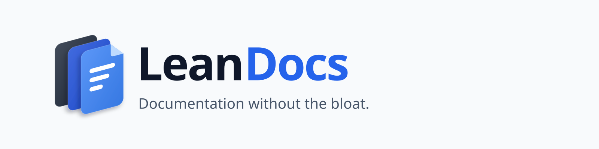
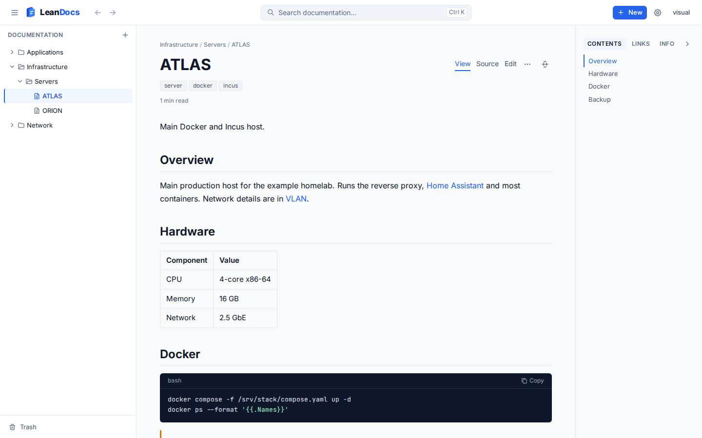

<picture>
  <source media="(prefers-color-scheme: dark)" srcset="branding/banners/readme-dark.svg">
  
</picture>

# LeanDocs

**Documentation without the bloat.**

LeanDocs is a lightweight, self-hosted documentation manager for technical people: homelabs, servers, networks, applications and runbooks. Every document is a plain Markdown file in a plain folder, so your documentation outlives the app.

## Features

- **Your files stay yours.** Folders and `.md` files on disk are the documentation; delete the app and everything is still there.
- **Visual or Markdown editing** of the same file, with tables, code highlighting, callouts, Mermaid diagrams and a table of contents.
- **Links that keep working.** `[[Wiki links]]` and relative links, backlinks, a broken-link report, and automatic updates when documents move.
- **Fast full-text search** with `tag:`, `path:` and `title:` filters and quick open.
- **Works alongside other tools.** Changes from other editors, `git pull` or scripts appear within about a second; editing conflicts are detected.
- **Attachments, templates, tags and pins**, plus import of Markdown folders, Obsidian vaults and HTML pages.
- **One container, no extra services.** No database server, no Redis, no telemetry; one administrator account with an optional authenticator app, or sign-in through your authentication gateway.

## Preview

<picture>
  <source media="(prefers-color-scheme: dark)" srcset="docs/images/document-dark.png">
  
</picture>

## Quick start

Requires Docker with the Compose plugin. The image runs as UID/GID 1000 by default; the `.env` below makes it use your user so you own the files in `./data`.

```bash
mkdir leandocs && cd leandocs
curl -fsSLO https://raw.githubusercontent.com/pbuzdygan/leandocs/main/compose.yaml
mkdir -p data
printf 'LEANDOCS_UID=%s\nLEANDOCS_GID=%s\n' "$(id -u)" "$(id -g)" > .env
docker compose up -d     # then open http://localhost:8080
```

> **Create the administrator account right away.** The first person who opens a new installation creates it. To keep a trial reachable only from this machine, add `LEANDOCS_BIND=127.0.0.1` to `.env` before starting.
>
> **Your documentation lives in `./data`** (`data/content` for documents, `data/system` for accounts and settings). Back up the whole folder.

For HTTPS behind a reverse proxy, pinned versions, updates and backups, follow the [deployment guide](docs/deployment.md).

## Documentation

**Using LeanDocs**

- [Deployment](docs/deployment.md) — install, HTTPS reverse proxies, updates, backup and restore.
- [Configuration](docs/configuration.md) — every setting, storage layout and sign-in modes.
- [Importing](docs/import.md) — bring in Markdown folders, Obsidian vaults or HTML pages.
- [Markdown](docs/markdown.md) — supported syntax.
- [Attachments](docs/attachments.md) — pictures and files in documents.
- [Changelog](CHANGELOG.md) — what changed in each version.

**Developing LeanDocs**

- [Contributing](CONTRIBUTING.md) — workflow, commits and changelog rules; AI agents also follow [`AGENTS.md`](AGENTS.md).
- [Development](docs/development.md) — local setup, tests and releases.
- [Architecture](docs/architecture.md) — how the code is organised.
- [Product](PROJECT_SPEC.md) and [UI](UI_SPEC.md) specifications.
- [Architecture decisions](docs/adr/) and [smaller decisions and known issues](docs/decisions.md).

## Project links

- [MIT License](LICENSE) — bundled third-party libraries keep their own licenses.
- [Security policy](SECURITY.md) — report vulnerabilities privately; security review findings.
- [Issues](https://github.com/pbuzdygan/leandocs/issues) — bug reports and questions.
